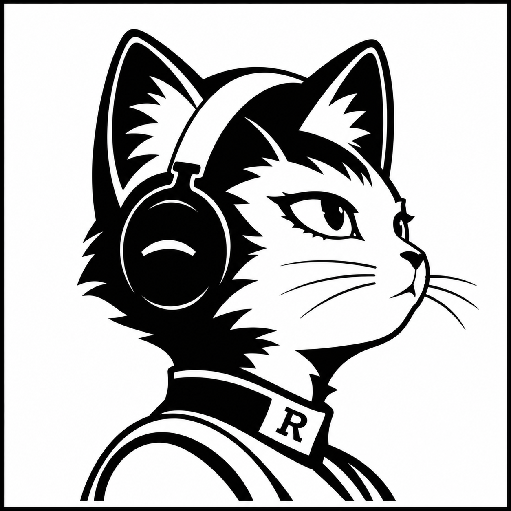

# Herune

<p align="center">
  
</p>

**A native desktop client for Hermes, built with Rune.**

Herune connects to independently managed [Hermes agents](https://github.com/NousResearch/hermes-agent)
on your machine or a remote server. It does not bundle an agent or take over its
lifecycle. Closing Herune leaves your agent running.

The active client is written in Rust with Rune. It brings conversations and
streaming, bot/profile navigation, settings, terminal and file views into a native
window, with System / Light / Dark appearance and color presets.

**Development alpha.** Full functional and cross-platform parity is still in
progress. See [the native client guide](apps/rune/README.md) and
[the parity tracker](apps/rune/docs/functional-parity.md) for capabilities,
verification boundaries and remaining work.

## Build and run

Node 26+, npm 11.17+, Rust 1.95.0 and the platform's native prerequisites are required. The
[platform setup guide](apps/rune/README.md#build-and-run) lists them.

```sh
npm ci
npm run dev
npm run dev -- --gateway https://your-existing-gateway.example
npm run build
npm run test:rune
```

The native commands generate the plugin host from JavaScript source before building.
Rune and other native dependencies are pinned in the Cargo lockfile. The SDK and
lockfile are currently being integrated; a clean-source build is still pending.

## Connect your agent

Use Settings → Connections to select a local agent, remote gateway or SSH
connection. For gateways supporting Nous sign-in, choose OAuth and finish the
browser flow. Saved credentials stay in the OS credential store.

Herune uses existing Hermes APIs for profiles, conversations and tools. It keeps
agent configuration separate from client preferences. Direct remote OAuth chat
and history restoration have been verified in the installed macOS build.

## Packaging

The macOS application is **Herune.app**. Native packaging recipes for macOS,
Linux and Windows are in [apps/rune/packaging](apps/rune/packaging/README.md).
Signing and installed-platform acceptance remain separate from compilation.

The original bundle ID, client data directory, Keychain service and
`hermes-rune://` compatibility scheme are retained so existing installs keep
their settings and saved credentials. The product artwork and icon variants
live in [apps/rune/assets/branding](apps/rune/assets/branding).

## Source and attribution

Herune is independently maintained and hosted. Its Git history retains its
origin in [NousResearch/hermes-agent](https://github.com/NousResearch/hermes-agent).
The original GitHub fork is preserved separately as
[hermes-desktop-rune-archive](https://github.com/nggurbanov/hermes-desktop-rune-archive).

The Electron desktop remains the behavioral and spatial baseline for the native
port. Its exact source and history are preserved in the
[Electron reference archive](https://github.com/nggurbanov/herune/tree/archive/electron-reference-20261101/apps/desktop).

The upstream snapshot and client protocol provenance are recorded in
[desktop-baseline.json](desktop-baseline.json). Hermes retains ownership of agent
execution, profiles, sessions, memory and tools.

Upstream copyright and MIT license notices are preserved in [LICENSE](LICENSE).
Rune/OpenCode, T3 Code theme provenance and other dependency notices are in
[THIRD_PARTY_NOTICES.md](apps/rune/THIRD_PARTY_NOTICES.md).
